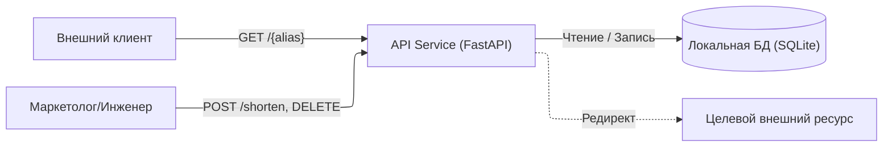
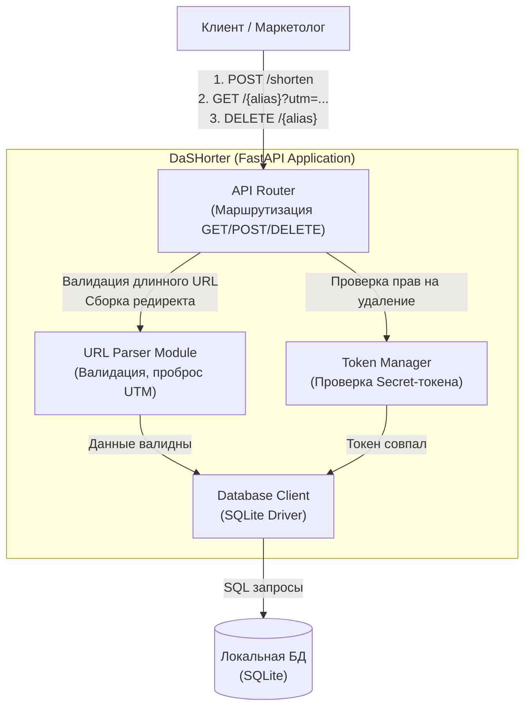

# Проект: DaSHorter>> v. 1.0

## 1. Паспорт проекта

**Участники:** Дараган Даниил Дмитриевич, МСПИН-251 -- Привезенцев Даниил Алексеевич, МСПИН-251  
**Продукт:** DaSHorter. Лаконичный web-сервис кратких ссылок с поддержкой проброса UTM-меток, настраиваемым TTL и управлением через SecretToken
**Планируемый выпуск:** v1.0 - ReleaseCandidate 1
**Исходное состояние:** fc40248d50ab796e15973985ff08279df67a5e46
**Репозиторий:** [<ссылка>](https://git.cs.hse.ru/dddaragan/HighlandTech)

### Контекст и пользователи

Сервис разрабатывается командой из 2 студентов:
Backend-разработчика
QA-инженера/SDET

Цель: Внутреннее использование тестировщиками, маркетологами, разработчиками, публикации ссылок для внешних клиентов.
Решение о выпуске версии принимается совместно обоими инженерами после проверки безопасности логики парсинга URL и маршрутизации.

**Роли пользователей:**
Маркетологи и инженеры: отправляют длинный URL, получают короткий алиас и секретный токен для управления им.
Клиенты: переходят по короткой ссылке. Для них важна скорость редиректа и корректный проброс параметров (напр. ?utm_source=tg для отсылки на всем известный и любимый мессенджер)

### Границы

**В проект входит:**

Backend API -- Стек: Python, фреймворк FastAPI, использование urllib.parse для работы с URL;
локальная база данных для хранения ссылок и статистики -- SQLite;
логика валидации входящих длинных URL;
механизм проброса query-параметров при редиректе;
механизм отзыва ссылки по секретному Secret-токену;
Dockerfile и конфигурация для локального запуска -- docker-compose.

**За пределами проекта:**

GUI управления (frontend/админка);
логика регистрации, логины и пароли пользователей;
публикация сервиса в интернет (развертывание, реальные сервера)

### Компоненты, взаимодействия и границы доверия

**Контекстный уровень:** показывает взаимодействие пользователей с внешним API и перенаправление на сторонние ресурсы.
Здесь проходит главная граница доверия между недоверенной внешней средой и нашим приложением.

**Уровень компонентов**: раскрывает внутреннее устройство DaSHorter. 
Вся бизнес-логика (URL Parser, Token Manager, DB Client) находится внутри единой границы доверия сервера. Валидация всех внешних данных (incl. urllib.parse) 
строго инкапсулирована внутри сервиса до момента обращения к БД.

### Активы и существенные риски

▲ Актив: Токены отзыва.
Что может произойти: Несанкционированный доступ к чужим токенам или их утечка.
Почему это существенно: Злоумышленник сможет удалять чужие рабочие ссылки, нарушая доступность сервиса.

▲ Актив: Целевой URL и механизм редиректа.
Что может произойти: Подмена логики редиректа через манипуляцию query-параметрами.
Почему это существенно: Сервис станет инструментом для фишинга, что приведет к блокировке домена и потере репутации.

▲ Актив: Вычислительные ресурсы сервиса.
Что может произойти: Массовое автоматическое создание мусорных ссылок или исчерпание памяти.
Почему это существенно: Отказ в обслуживании легитимных пользователей -- нагрузка, DoS.

### Доступные материалы и ограничения

- [ ] исходный код и история изменений;
- [ ] возможность собрать или запустить продукт;
- [ ] зависимости и файлы сборки -- requirements, Dockerfile/docker-compose.yml;
- [ ] тесты;
- [ ] конфигурации;
- [ ] CI/CD -- планируется в рамках улучшения;
- [ ] возможность изменить продукт и повторить проверку.

**Недоступно:** Продукт не имеет production-инфраструктуры, анализируется тестовая среда.
**Конфиденциальность:** Ограничений нет, все исходники, схемы и результаты проверок могут быть опубликованы в рамках учебного проекта.  
**Почему проект выполним:** Команда имеет полный контроль над кодом, может локально запустить сервис в контролируемой среде, внести исправления в код и повторно прогнать тесты, получив проверяемый результат.

## 2. Методологическая основа

**Основная рамка:** NIST SSDF 1.1
**Дополнительные источники:** OWASP ASVS 5.0.0

**Требования проекта к рамке:**
- Должна подходить для небольшого web-продукта.
- Должна охватывать весь жизненный цикл, а не только тестирование.
- Должна позволять выбрать небольшой набор применимых практик.
- Должна помогать связать технические результаты проверок с решением о выпуске v1.0.

**Почему выбрана эта основа:** 
Основной рамкой выбран NIST SSDF 1.1, потому что проекту нужна компактная основа полного SDLC, которую можно встроить в наш процесс. OWASP ASVS 5.0.0 используется только как дополнительный каталог проверяемых технических требований для валидации логики API.

Почему? - SSDF не содержит технической специфики web-приложений.

**Что ещё рассматривали (отклонённые варианты):** 
- *ГОСТ Р 56939-2024:* отклонён как основная рамка. Хотя стандарт отлично структурирует процессы, его требования к формальному разделению ролей и документации слишком ёмкие, для MVP двух студентов - рудиментарно.
- *OWASP SAMM 2:* отклонён, так как это модель оценки зрелости в корпо-масштабах, а нашей задачей является проверка конкретного приложения, а не всей организации.

**Выбранные положения основной рамки (NIST SSDF 1.1) для адаптации:**

**1. Источник и положение: NIST SSDF PO.1.1 (Определение требований безопасности).**
Применимость: полностью.
Почему это относится к нашему продукту: перед разработкой API нужно понимать, от кого мы защищаемся.
Какое действие выполняем: зафиксировать границы доверия и модель нарушителя для v1.0.
Кто отвечает: *Дараган Даниил*.
Какой результат остаётся: описание границ в паспорте проекта.
Как проверяет выполнение: ревью текста документа вторым участником (Даниил Привезенцев) перед мерджем.
Что сознательно упрощаем: отказываемся от формального моделирования угроз, оставляем только базовое описание.

**2. Источник и положение: NIST SSDF PS.1.1 (Защита репозиториев кода).**
Применимость: полностью.
Почему это относится к нашему продукту: мы храним исходный код web-сервиса в Git.
Какое действие выполняем: настроить защиту ветки main (запрет прямого пуша).
Кто отвечает: *Дараган Даниил*.
Какой результат остаётся: конфигурация репозитория (Branch protection rules).
Как проверяем выполнение: попытка прямого push в main должна блокироваться системой.
Что сознательно упрощаем: не используем сложные системы управления доступом и ролевые модели, так как нас всего двое.

3. **PW.4 (Повторное использование безопасного кода):** превратится в проверку зависимостей (`requirements.txt`) перед сборкой DockerImahe.

**4. Источник и положение: NIST SSDF RV.1.1 (Анализ кода на уязвимости).**
Применимость: частично.
Почему это относится к нашему продукту: код на Python+FastAPI может содержать инъекции и логические ошибки.
Какое действие выполняем: запустить SAST-сканер (Bandit) при создании Merge Request.
Кто отвечает: *Дараган Даниил*.
Какой результат остаётся: лог CI/CD пайплайна с результатами сканирования.
Как проверяем выполнение: MR не вливается без зеленого пайплайна.
Что сознательно упрощаем: не настраиваем DAST и IAST сканирование - только статический анализ.

5. **RV.2 (Устранение уязвимостей):** превратится в правило блокировки релиза `v1.0`, если найдены критические баги в логике валидации URL.
#~ *Ты тут хотел добавить RV 3.1, оставляю чекпоинт, нужно в таком же формате.*

## 3. Текущее состояние

<Как продукт реально разрабатывается и выпускается сейчас. Укажите, на каких файлах, настройках, наблюдениях или действиях основан вывод.>

### Существенные разрывы

- **Разрыв:** ...  
  **Почему важен:** ...  
  **Свидетельство:** ...  
  **Приоритет:** высокий / средний / низкий

Отсутствие зрелого формального процесса само по себе не является разрывом. Выбирайте только то, что влияет на безопасность или обоснованность выпуска.

## 4. Целевой Secure SDLC

Опишите выполнимую схему для этого продукта:

- какие практики обязательны для каждого выпуска, а какие включаются по риску;
- кто выполняет работу и кто принимает решение;
- какие результаты остаются после выполнения практик;
- где находятся контрольные точки;
- как оформляются исключения, принятие риска и эскалация;
- что именно команда успевает реализовать в рамках курса.

## 5. Технологический профиль

Выберите методы по рискам и свойствам продукта. Общего обязательного набора инструментов нет.

### Метод 1: <название>

**Риск или свойство:** ...  
**Цель:** ...  
**Область проверки:** ...  
**Этап жизненного цикла:** ...  
**Способ или инструмент и версия:** ...  
**Ведущий участник:** ...  
**Как партнёр проверит результат:** ...  
**Ожидаемые свидетельства:** ...  
**Что метод не покрывает:** ...

<Добавьте другие методы только при необходимости. У каждого участника должен быть хотя бы один собственный содержательный участок работы.>

## 6. Практическая апробация

Для каждого выбранного метода укажите:

- что именно проверялось;
- команду запуска или понятную последовательность действий;
- версию инструмента и ссылку на конфигурацию;
- ссылку на существенные результаты в `evidence/`;
- что удалось и не удалось воспроизвести;
- какие ограничения есть у результата.

## 7. Результаты и триаж

Соберите только существенные результаты. Для каждого результата укажите:

- вывод: подтверждён / ложное срабатывание / неприменимо / требует дополнительной проверки;
- основание решения;
- влияние на планируемый выпуск;
- ссылку на свидетельство.

Если существенных проблем не найдено, так и напишите. Объясните, что именно было проверено, почему результат содержателен и чего он не доказывает.

## 8. Улучшение и повторная проверка

**Что улучшили:** ...  
**Какой риск или разрыв это уменьшает:** ...  
**Почему выбрано именно это улучшение:** ...  
**Ссылка на изменение:** ...  
**Как повторили проверку:** ...  
**Результат до и после:** ...  
**Вклад первого участника:** ...  
**Вклад второго участника:** ...

Улучшение может относиться к коду, конфигурации, сборке, тестированию, настройке проверки или воспроизводимости. Специально создавать уязвимость не нужно.

## 9. Решение о выпуске

**Решение:** выпускать / выпускать с условиями / отложить выпуск  
**Основания:** <ссылки на ключевые результаты>  
**Блокирующие проблемы:** <есть или нет>  
**Остаточные риски:** ...  
**Условия, исключения и ответственные:** ...

Поясните, почему собранных свидетельств достаточно именно для такого решения, а не для утверждения о полной безопасности продукта.

## 10. Метрики и программа развития

Укажите несколько полезных показателей и план улучшений на 6–12 месяцев. Для ближайших действий задайте приоритет, ожидаемый результат и ответственного. Не добавляйте метрики, которые команда не сможет интерпретировать.

## 11. Управленческая записка

<Краткое самостоятельное резюме: продукт и выпуск, что проверено, что улучшено, какие риски остались и какое решение предлагается. Ориентир — около одной страницы без пересказа всего проекта.>

## 12. Использование генеративного ИИ

**Использовался ли ИИ:** да / нет  
**Для чего:** ...  
**Какие части продукта или проекта созданы с его помощью:** ...  
**Какие данные передавались:** ...  
**Как команда проверила результат:** ...

Не публикуйте промпты целиком, если это не помогает проверить результат.