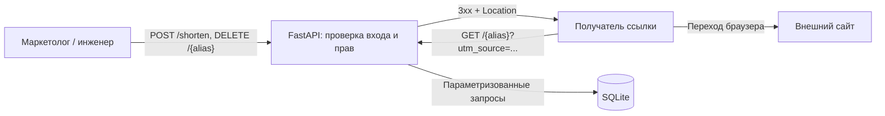
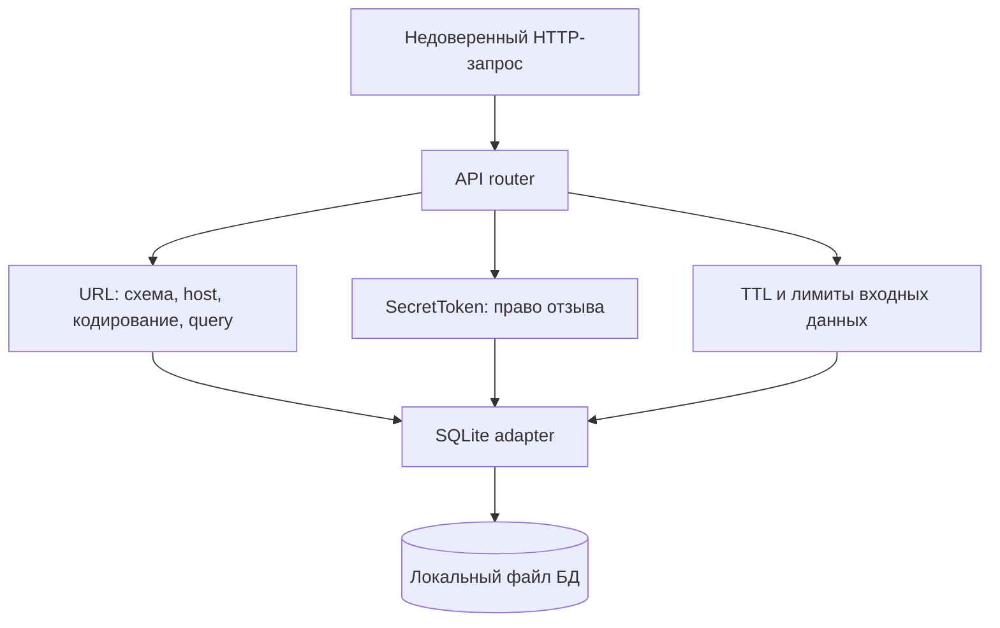

# Проект DaSHorter — методика безопасной разработки

## 1. Паспорт проекта

**Участники:** Дараган Даниил Дмитриевич и Привезенцев Даниил Алексеевич, МСПИН-251.

**Учебные адреса:** Дараган — `dddaragan@edu.hse.ru`; Привезенцев — `daprivezentsev@edu.hse.ru` (из сохранённой истории проекта).

**Продукт учебного сценария:** DaSHorter — web-сервис коротких ссылок с сохранением UTM-параметров, TTL и управлением через SecretToken.

**Планируемый выпуск сценария:** `v1.0-rc1` для локальной тестовой среды; публичная эксплуатация в его границы не входит.

**Предмет настоящей работы:** проектирование методики безопасной разработки. Приложение и его функции принимаются как условия учебного сценария. В этом репозитории описываются требования, риски, роли, действия, контрольные точки и ожидаемые свидетельства. Реализация приложения и её техническое испытание не входят в текущую итерацию. Фактические результаты проверок не подменяются модельными примерами.

**Точка отсчёта репозитория:** [`fc40248d50ab796e15973985ff08279df67a5e46`](https://github.com/daniil-novel/HighlandTech/commit/fc40248d50ab796e15973985ff08279df67a5e46), initial commit документационного проекта. **Исходная редакция перед данной доработкой:** [`e2f2bd4554550234e9e93838dcf7b9f0e2aea01c`](https://github.com/daniil-novel/HighlandTech/commit/e2f2bd4554550234e9e93838dcf7b9f0e2aea01c), `main` на 19.10.2026. Эти SHA относятся к методике; технические проверки при её применении связываются с отдельным SHA реализации и digest образа.

**Рабочий репозиторий:** [daniil-novel/HighlandTech](https://github.com/daniil-novel/HighlandTech). [GitLab HSE](https://git.cs.hse.ru/dddaragan/HighlandTech) — прежняя площадка работы. История сохранена, настройки двух площадок рассматриваются отдельно.

### Контекст, роли и пользователи

Маркетолог или инженер создаёт короткую ссылку и получает отдельный секрет для её отзыва. Получатель переходит по алиасу. Существенны корректный адрес перенаправления, ожидаемая работа UTM и TTL, сохранность права удаления и доступность API. В учебных сценариях используются искусственные URL, токены и данные.

Привезенцев ведёт Backend, зависимости и инфраструктуру разработки. Дараган ведёт QA/SDET, проверки поведения и комплект выпуска. Автор готовит изменение; партнёр проверяет его смысл, влияние и результаты. Слияние и выпуск — разные решения. Решение о выпуске принимают оба участника, QA фиксирует его после сверки комплекта, Backend подтверждает состав версии и обработку блокирующих вопросов.

### Границы продукта

В сценарий входят Python/FastAPI API, обработка URL средствами `urllib.parse` с явной валидацией, SQLite, создание алиаса, редирект с определённым правилом объединения query-параметров, TTL, отзыв по SecretToken и локальный запуск через Docker Compose.

За границами находятся GUI, аккаунты и пароли пользователей, публичное развёртывание, круглосуточная эксплуатация и полноценная система противодействия фишингу. Корректный парсинг URL не устанавливает благонадёжность внешнего сайта. При переходе к открытому сервису потребуются отдельные правила допустимых адресатов, ограничения злоупотреблений и эксплуатационная инфраструктура.

### Компоненты и границы доверия

Клиентские URL, query-параметры, алиасы и токены недоверенные. Сервер проверяет их до использования в запросах к БД или заголовке `Location`. При редиректе внешний ресурс открывает браузер клиента; серверная загрузка целевого URL не входит в архитектуру. Если она появится, потребуется отдельная оценка SSRF.

Доступ к файлу SQLite и данным контейнера рассматривается отдельно от API: возможность изменить БД позволяет обойти проверки приложения. Поэтому права на данные, контекст сборки и параметры запуска входят в методику.

### Активы, риски и проверяемые свойства

| Актив и риск | Требование сценария | Ожидаемый способ подтверждения |
| --- | --- | --- |
| URL и `Location`: изменение адресата через query, неоднозначный разбор, опасная схема | Только `http`/`https` с допустимым host; query перехода не меняет scheme/host/path сохранённой цели; CR/LF не попадают в заголовок | Негативные и интеграционные сценарии метода 1 |
| SecretToken: удаление чужой ссылки или утечка секрета | Удаление только с токеном нужного алиаса; токен непредсказуем, не передаётся в URL и не сохраняется в обычных логах | Ревью генерации/проверки и сценарии двух разных ссылок |
| Доступность и TTL: чрезмерный ввод, переполнение, устаревшие алиасы | Пределы размера и срока жизни определены; истёкшая ссылка не обслуживается | Граничные сценарии и проверка состояния после TTL |
| Код, конфигурации и образ: непроверенное изменение или уязвимый компонент | Изменение проверяет партнёр; состав сборки воспроизводим; существенные находки разобраны | PR, настройки доступа, тесты и SCA для конкретных SHA/digest |

Численные пределы URL и TTL, политика повторяющихся query-ключей и HTTP-ответы на ошибки фиксируются при подготовке конкретного изменения до реализации. Методика требует явного ожидаемого результата; поведение библиотеки по умолчанию не заменяет решение команды.

### Что уже оформлено в методике

Определены продукт и выпуск сценария, активы и границы доверия, выбраны SSDF и технические ориентиры ASVS, распределены функции Backend/QA, заданы два направления проверок. В репозитории сохранены история изменений обоих участников, карточки выбора рамок, `requirements.txt`, `Dockerfile` и Compose как предметы применения правил. [Статический аудит](evidence/repository-audit.md) фиксирует фактический состав документационного репозитория и настройки GitHub.

Далее описан порядок применения методики к разработке и выпуску DaSHorter. Наличие проектного правила подтверждается текстом и историей; его техническое исполнение при реальной разработке подтверждается отдельными результатами. Общие требования курса к последующей практической части приведены в [сопоставлении](docs/course-alignment.md).

## 2. Методологическая основа

**Основная рамка:** NIST SSDF 1.1, NIST SP 800-218, февраль 2022 года.

**Дополнительный источник:** OWASP ASVS 5.0.0 — выборочные технические требования для web/API. Полное соответствие SSDF или всем требованиям уровня ASVS L1 не заявляется.

SSDF подходит DaSHorter, потому что позволяет связать требования к URL, токенам и TTL с изменением кода, защитой репозитория, проверками зависимостей и решением о выпуске. ASVS уточняет технические свойства, но не заменяет организационную рамку жизненного цикла.

Рассмотрены также ГОСТ Р 56939-2024 и OWASP SAMM 2. ГОСТ задаёт применимые процессы безопасной разработки; маленькая команда может совмещать роли, поэтому число участников само по себе не является основанием для отказа. В текущей итерации выбран более компактный профиль SSDF, а соответствие ГОСТ не оценивается. Это согласуется с [карточкой Привезенцева](chernoviki_obsujdeniy/privezentsev_kartochka.md). SAMM подходит для оценки и развития зрелости организаций разного размера; отдельная оценка уровней зрелости сейчас не нужна для обоснования одного учебного выпуска. При развитии продукта эти варианты можно пересмотреть.

### Адаптированный профиль

Ниже семь областей, охватывающих все четыре группы SSDF: **PO** — подготовка организации, **PS** — защита ПО, **PW** — создание защищённого ПО, **RV** — реагирование на уязвимости. «Применимость» показывает пригодность положения к проекту; это не статус внедрения. Действия описывают целевой процесс. Выполнение подтверждается только конкретным свидетельством из раздела 3 или позднейшей апробации.

**1. Требования, обязанности и критерии — PO.1.1, PO.1.2; организационная опора PO.2.1, PO.4.1–PO.4.2.**

- **Смысл источника:** PO.1.1 относится к безопасности инфраструктуры и процессов разработки; PO.1.2 — к требованиям разрабатываемого продукта. PO.2.1 задаёт ответственность, PO.4.1–PO.4.2 — критерии проверок и сбор необходимых оснований.
- **Применимость:** частичная: цели сохраняются, корпоративные процедуры заменяются правилами пары.
- **Связь с продуктом и действие:** определить проверяемые требования к схемам URL и сборке редиректа, управлению SecretToken, истечению TTL и зависимости выпуска от результатов проверок; отдельно установить правила доступа, review и сохранения результатов. Пересматривать затронутые требования при изменении API, зависимостей, границ или существенной находке.
- **Ответственность:** Привезенцев формулирует техническое поведение API и ограничения реализации; Дараган проверяет проверяемость требований и критерии допуска. Оба согласуют роли и существенные изменения требований.
- **Результат и контроль:** паспорт и таблица свойств раздела 4, обсуждение в PR, решение в контрольной точке. Партнёр проверяет цепочку «риск → требование → сценарий → свидетельство». Само описание границ не заменяет требований.
- **Упрощение:** один `project.md`, без отдельной службы безопасности и полного корпоративного каталога политик. Отсутствие отдельной роли не отменяет назначенного исполнителя и второго взгляда.

**2. Защита кода — PS.1.1.**

- **Смысл источника:** хранить код, исполняемые компоненты и конфигурации по принципу минимальных прав, защищая их от неразрешённых изменений.
- **Применимость:** частичная: рассматриваются Git-репозиторий и учебные сборки; защищённая production-среда отсутствует.
- **Связь с продуктом и действие:** ограничить права записи, готовить изменения в ветке, применять PR и проверку партнёром. Проверить и сохранить действующие настройки защиты `main` именно в используемом GitHub-репозитории; не считать старую метку `protected` в GitLab доказательством правил GitHub.
- **Ответственность:** Дараган ведёт проверку доступных правил репозитория; изменение настроек выполняет участник с фактическими правами администратора. Привезенцев проверяет результат. Если полномочий нет, это остаётся открытым вопросом.
- **Результат и контроль:** запись настроек без секретов и PR с review, привязанные к дате и репозиторию. В контрольной точке слияния проверяется одобрение второго участника; автор не одобряет себя.
- **Упрощение:** без отдельной системы управления корпоративными доступами. Пока технический запрет не подтверждён, действует явно обозначенный ручной порядок; его нельзя называть доказанной защитой ветки.

**3. Сторонние компоненты — PW.4.4.**

- **Смысл источника:** проверять соответствие приобретённых и открытых компонентов установленным требованиям на протяжении их жизненного цикла. Поиск известных CVE — только часть этой задачи.
- **Применимость:** частичная: ближайшая итерация охватывает Python-пакеты и контейнер, проверки при изменении зависимостей и перед выпуском.
- **Связь с продуктом и действие:** анализировать фактически разрешённые прямые и транзитивные версии `requirements.txt`, отдельно — компоненты образа из `Dockerfile`; фиксировать digest, происхождение базового образа, поддержку выбранных версий и решения по применимым находкам. Ограничения `>=` и тег `python:3.11-slim` сами по себе не фиксируют состав сборки.
- **Ответственность:** Привезенцев выполняет анализ, Дараган проверяет область, интерпретацию и связь результата с кандидатом выпуска.
- **Результат и контроль:** отчёты, версии, команды, конфигурации и триаж в `evidence/`. При нерешённой применимой критической уязвимости выпуск блокируется.
- **Упрощение:** не заявляются непрерывный мониторинг, полный аудит исходников зависимостей и полная проверка цепочки поставки. Возвращаемся к ним при длительном сопровождении или публикации сервиса; до этого ограничение отражается в решении о выпуске.

**4. Ревью и анализ кода — PW.7.1–PW.7.2.**

- **Смысл источника:** выбрать подходящие методы ревью/анализа, выполнить их, зарегистрировать и разобрать находки в рабочем процессе команды.
- **Применимость:** частичная: собственный Python-код и связанные конфигурации в доступном учебном репозитории.
- **Связь с продуктом и действие:** при изменении URL-парсинга, SQL, токенов и сборки выполнять review по короткому списку правил; при применении к исходному коду использовать выбранный статический анализатор, предварительный кандидат — Bandit. Замечания записывать в PR/Issue и разбирать, включая ложные срабатывания.
- **Ответственность:** автор исправляет изменение, партнёр проверяет. Дараган ведёт настройку анализа; Привезенцев проверяет её применимость и замечания по коду.
- **Результат и контроль:** review, конфигурация и отчёт анализатора для конкретного SHA. Чистый отчёт не заменяет review и тесты бизнес-логики.
- **Упрощение:** сначала воспроизводимый ручной запуск, затем CI с теми же критериями. Ни SSDF, ни эта карточка не делают Bandit универсальной проверкой URL/SecretToken. Отказ от IAST не является сокращением смысла PW.7.2, поскольку это другая область проверки.

**5. Проверка исполняемого продукта — PW.8.1–PW.8.2.**

- **Смысл источника:** выбрать виды тестирования по оставшемуся риску, определить область, выполнить проверки и сохранить результаты с триажем.
- **Применимость:** частичная: локальная контролируемая среда, без production и внешнего нагрузочного испытания.
- **Связь с продуктом и действие:** на запускаемом API проверить опасные схемы и неоднозначные URL, правила UTM, удаление с неверным/верным токеном, истечение TTL и выбранные границы входа. Предварительный способ — параметризованные security-тесты; фаззинг добавляется при наличии цели и воспроизводимого результата.
- **Ответственность:** Дараган ведёт сценарии и запуск; Привезенцев проверяет ожидаемое поведение и воспроизводит существенную часть.
- **Результат и контроль:** сценарии, команды и результаты для кандидата выпуска; сопоставление с согласованными требованиями в контрольной точке выпуска.
- **Упрощение:** без обязательного полного пентеста и дорогостоящих DAST/IAST. Остаточный риск этих ограничений фиксируется; обычный успешный запрос не подтверждает безопасность всех входов.

**6. Приём сообщений, триаж и реакция — RV.1.1, RV.2.1–RV.2.2.**

- **Смысл источника:** собирать и расследовать достоверные сообщения, определить риск находки, затем спланировать и выполнить реакцию.
- **Применимость:** частичная: учебное использование и канал команды, без круглосуточной службы реагирования.
- **Связь с продуктом и действие:** сообщение от партнёра, результат теста/анализа или значимая новая информация о компоненте становятся Issue; определить затронутую версию, воспроизводимость, влияние, применимость, решение, исполнителя и срок. Исправление проходит PR и повторную проверку. Сообщения с токенами и иными секретами не размещаются в публичном Issue.
- **Ответственность:** получивший сообщение регистрирует его безопасное описание; Привезенцев ведёт исправление, Дараган проверяет результат. Остаточный риск и исключения принимаются совместно в пределах проекта.
- **Результат и контроль:** Issue, свидетельство, решение по находке, исправление и повторный результат. Отсутствие ответа, недоступность партнёра и недостающий отчёт не считаются разрешением на выпуск.
- **Упрощение:** вместо единого SLA — срок и приоритет конкретной находки. Непрерывный автоматический сбор всех источников и автоматизированная доверенная доставка исправлений пока не заявляются.

**7. Первопричины и предотвращение повторения — RV.3.1, RV.3.4; последующее развитие RV.3.2–RV.3.3.**

- **Смысл источника:** RV.3.1 — причина выявленной уязвимости; RV.3.2 — повторяющиеся причины, выявляемые по накопленной истории; RV.3.3 — поиск похожих уязвимостей в других местах; RV.3.4 — изменение SDLC по выявленным причинам.
- **Применимость:** частичная, по риску. Краткий разбор обязателен для подтверждённой серьёзной или повторной проблемы; для остальных находок решение и объяснение остаются в триаже.
- **Связь с продуктом и действие:** определить причину, добавить регрессионный сценарий или правило review, проверить сходные места при наличии основания. Например, ошибка обработки URL требует проверить другие пути сборки редиректа, если они существуют в реализации.
- **Ответственность:** автор исправления описывает причину; партнёр проверяет её связь с изменением и повторным результатом. Оба принимают изменение процесса.
- **Результат и контроль:** несколько строк в том же Issue: причина, урок, изменение проверки, повторный результат. Выполненный RCA до появления такого следа не заявляется.
- **Упрощение:** отдельный большой RCA-отчёт для каждой находки не требуется. Анализ тенденций RV.3.2 планируется после накопления наблюдений; короткая история не позволяет объявить его уже выполненным.

### Границы выбора и источник

Не создаём отдельные документы на каждую практику, фиктивные должности и результаты. Корпоративные программы обучения, защищённая production-инфраструктура, полное соответствие цепочки поставки и долгосрочное реагирование не входят в обязательный объём ближайшей итерации. Их отсутствие не делает соответствующие цели SSDF неприменимыми вообще. При применении профиля выбранные проверки связываются с конкретной реализацией и повторным результатом полезного улучшения. Нынешняя итерация определяет этот порядок на уровне методики.

Номера задач и смысл сверены с [NIST SP 800-218, SSDF 1.1, таблица 1](https://nvlpubs.nist.gov/nistpubs/SpecialPublications/NIST.SP.800-218.pdf). Примеры реализации в этой таблице не выдаются за обязательные подпункты стандарта. Выборочные требования [ASVS 5.0.0](https://raw.githubusercontent.com/OWASP/ASVS/v5.0.0/5.0/OWASP_Application_Security_Verification_Standard_5.0.0_en.pdf) уточняются в технологическом профиле; номер главы без версии и конкретного требования не используется как доказательство соответствия.

## 3. Текущее состояние методики и инфраструктуры

Исходный срез — `e2f2bd4554550234e9e93838dcf7b9f0e2aea01c` на 19.10.2026. [Протокол](evidence/repository-audit.md) и [JSON](evidence/repository-audit.json) сохраняют дерево, историю и публичные ответы GitHub. Область диагноза — документация методики и доступная инфраструктура работы с ней. Приложение рассматривается по принятому сценарию раздела 1; его поведение этим аудитом не оценивается.

### Сильные элементы и уже выполненная работа

В истории есть содержательные изменения обоих участников, ветки и слияния. Определены архитектура, активы и риски, выбрана основная рамка, подготовлены карточки и два направления будущих проверок. Это реальные результаты проектирования безопасной разработки. Факт merge подтверждает работу с ветками, но не доказывает независимое review или обязательность запрета прямой записи.

### Существенные разрывы исходной редакции

| Разрыв | Наблюдение и ожидание | Что меняет методика | Применение и приоритет |
| --- | --- | --- | --- |
| G1. План и исполнение смешивались | В исходном тексте встречались заявления о действующих мерах при отсутствии технических результатов. Ожидание S04: различать положение, наблюдение, неизвестное и предложение | Для мер названы статусы, требуемые результаты и точки контроля; проектные примеры не называются состоявшимися проверками | Высокий для достоверности документа; исправляется этой редакцией |
| G2. Правила доступа не обеспечены GitHub | Публичный API: `main.protected=false`, rulesets пусты; у PR #1 нет сохранённых review. Историческая метка GitLab не описывает GitHub | Задан целевой запрет прямого push, минимальные права и второй взгляд. До технической настройки — явное ручное соблюдение процесса с сохранённым review | Высокий для значимых изменений; настройки меняет имеющий полномочия участник, партнёр проверяет |
| G3. Свойства API были слишком общими | Обещание «защиты от фишинга» шире проверки URL; недостаточно определены токен, TTL и UTM | Требования разложены на проверяемые свойства и сценарии; общий риск вредоносного адресата выделен отдельно | Высокий для требований. QA ведёт сценарии, Backend проверяет контракт |
| G4. Воспроизводимость состава не определена | `requirements.txt` содержит `>=`, образ — `python:3.11-slim`, без фиксированного digest. Декларации не определяют состав конкретного кандидата | Перед проверкой выпуска фиксируются разрешённые прямые/транзитивные версии и digest; SCA связывается с этим составом | Высокий до выпуска в сценарии. Backend ведёт состав, QA проверяет отчёт |
| G5. Не определена полнота проверок и их результата | В исходном дереве нет workflow и технических отчётов; Bandit упоминался как почти готовый контроль | Выбор инструмента отделён от его внедрения; определены ручной воспроизводимый запуск, сохранение результата, триаж и последующий перенос в CI | Сначала исполнимый регламент, затем автоматизация; отсутствие отчёта не означает нуль находок |
| G6. Конфигурации требуют правил безопасного применения | `COPY . .` без `.dockerignore`, нет `USER`, публикация `8000:8000`. Это статические параметры заготовки, а не подтверждённые runtime-инциденты | При локальном выпуске исключать лишний контекст, минимизировать права и явно ограничивать сетевую доступность; проверять доступ к SQLite | До использования конфигурации в конкретной сборке; Backend / QA |
| G7. Методология и решение не были согласованы | Некорректные ссылки PO.1.1/ASVS V5, вымышленные подпункты и несовместимые заявления об исключении/выполнении RCA; разделы 6–11 были подсказками | Исправлены источники, добавлены PW.8 и связный маршрут RV, заданы решение, метрики и развитие процесса | Высокий для целостности; исправляется этой редакцией и проверяется партнёром |

Проверка исходного дерева показывает восемь документационных и конфигурационных файлов, без реализации и технических отчётов. Для выбранного предмета работы это граница проверяемости, а не доказательство дефекта условного DaSHorter. Дальнейшие утверждения об исполнении практик должны ссылаться на соответствующие артефакты применения методики. Состояние личной 2FA и незафиксированные обсуждения публичный аудит не устанавливает.

## 4. Целевой Secure SDLC

### Область, статус и связь с текущим состоянием

Это предложение процесса подготовки **DaSHorter v1.0-rc1** для команды из двух человек. Оно охватывает API, URL-парсинг и сборку редиректа, SecretToken, TTL, SQLite, зависимости, тесты, Docker и документацию. Публичное развёртывание и эксплуатация реального сервера остаются вне границ. Описанные ниже проверки и настройки считаются внедрёнными только после появления соответствующего следа; сам этот раздел не подтверждает их выполнение.

Сохраняем полезную основу исходной работы: архитектуру и риски, выбранные рамки, историю веток, направления проверок и конфигурации. Разрывы раздела 3 превращаем в правила: уточняем требования и источник, определяем результаты проверок и разделение решений, проверяем доступ и второй взгляд на действующей площадке. Файлы зависимостей и контейнера становятся предметом контроля воспроизводимости и состава при применении методики.

### Что применено сейчас и как это развивается

Здесь «оформлено» означает конкретный результат разработки методики. Это позволяет показать уже сделанную работу, сохранив отдельный статус исполнения правил на коде и сборке.

| Практики | Уже оформлено в HighlandTech | Как применяется к разработке DaSHorter | Дальнейшее развитие |
| --- | --- | --- | --- |
| PO.1.1, PO.1.2, PO.2, PO.4 | Границы и активы, требования URL/TTL/SecretToken, роли, КТ-1/КТ-2 | Каждое изменение связывается с риском и ожидаемым свойством; партнёр проверяет полноту основания | Уточнять численные пределы и сценарии при изменении API; хранить связь требования с тестом |
| PS.1.1 | Сохранена история веток, определён PR-процесс; фактические настройки GitHub проверены | Контролируется право изменять исходники, конфигурации и артефакты; review предшествует значимому слиянию | Включить доступную техническую защиту, периодически пересматривать права и токены доступа |
| PW.4.4 | Выделены Python-зависимости и образ, требования к составу, digest и триажу | Проверяется именно включённый компонент, а не абстрактная библиотека; решение зависит от применимости | Lock/digest, периодический пересмотр компонентов, расширение контроля происхождения |
| PW.7.1–PW.7.2 | Заданы предмет review, кандидат статанализа, запись замечаний и условия остановки | Партнёр проверяет безопасность изменения; автор исправляет и предъявляет повторный результат | Автоматизировать повторяемые команды после локальной воспроизводимости |
| PW.8.1–PW.8.2 | Составлен профиль поведения и негативных/граничных сценариев | Проверяются пользовательские свойства редиректа, токена и TTL для кандидата | Реализовать и поддерживать сценарии в рабочем цикле; расширять генерацию входов по риску |
| RV.1, RV.2 | Описаны приём сообщения, риск, реакция, срок и связь с версией | Находка превращается в конкретное исправление или ограниченную меру, а не только severity | Наблюдать фактическое время реакции и добавить источники сигналов при сопровождении |
| RV.3.1, RV.3.4 | Заданы триггеры краткого RCA и изменение правила/теста | Серьёзная или повторная ошибка меняет следующий цикл разработки | При накоплении данных анализировать тенденции RV.3.2 и искать похожие дефекты RV.3.3 |

### Роли и правила принятия решений

- **Привезенцев Даниил — Backend:** ведёт исходный код, работу с зависимостями, техническое исправление и подготовку кандидата сборки. Для изменений Дарагана проверяет код, тесты, настройки и документацию.
- **Дараган Даниил — QA/SDET:** ведёт сценарии проверок, настройку анализа и проверку комплектности выпуска. Для изменений Привезенцева выполняет review и проверяет существенные результаты.
- **Автор изменения** объясняет затронутое свойство, выполняет применимые проверки и исправляет замечания. **Партнёр** даёт второй взгляд; самопроверка не заменяет его одобрение.
- **Слияние** фиксирует Привезенцев после допуска в КТ-1. Если он автор изменения, основанием остаётся review Дарагана. **Решение о выпуске** Дараган записывает в разделе 9 после совместного рассмотрения результатов в КТ-2. Разногласие или отсутствие второго участника ведёт к отсрочке, а не к единоличному исключению.

Это распределение функций по PO.2.1; дополнительные сотрудники не предполагаются. Право изменять настройки репозитория определяется фактическими разрешениями платформы. Участник без такого права может подготовить требование и проверить доступный результат, но не считается выполнившим настройку.

### Путь изменения и обязательное ядро

**Требование и риск → рабочая ветка → PR и второй взгляд → применимые проверки и триаж → КТ-1 «слияние» → кандидат выпуска и комплект свидетельств → КТ-2 «готовность выпуска» → обратная связь.** Если результата недостаточно, изменение возвращается автору или сбор оснований продолжается.

1. Автор создаёт ветку от актуального `main`. В PR указывает цель, связанный риск/Issue, затронутые требования, состав изменения и требуемые проверки. Для документационной правки отмечает, почему повтор технических тестов не требуется. Изменение API, URL, токена, TTL, SQL, зависимостей или сборки всегда считается значимым.
2. Партнёр проверяет решение, diff, тестовые ожидания, отсутствие лишних файлов и секретов, а также соответствие документации фактам. Для кода применяются согласованные правила: явная валидация входа, параметризованные SQL-запросы, безопасная работа с секретами и отсутствие утечки токенов в результатах. Эти правила применяются к любой реализации принятого API и входят в короткий список review.
3. Автор выполняет проверки по затронутому риску. Находки сохраняются в PR/Issue с решением «подтверждено / ложное срабатывание / неприменимо / нужна дополнительная проверка». Исправление требует повторного результата. Новый значимый diff после review предъявляется партнёру повторно.
4. До КТ-1 у изменения есть проверенное партнёром основание. Обязательное ядро включает понятную цель, второй взгляд, результаты требуемых проверок и отсутствие открытых блокирующих замечаний. Обычные тесты сохраняются в наборе регрессии; их успешность не доказывает все свойства безопасности.
5. Перед КТ-2 собирается отдельный комплект для конкретного SHA и кандидата образа. Уже проверенный PR не освобождает от проверки взаимодействия частей и конфигурации итогового кандидата.

### Действия по свойству и риску

Таблица задаёт целевые критерии PO.1.2 и PO.4.1. Детальные входы, коды ответа и граничные значения согласуются до реализации и фиксируются в тестах; они не восстанавливаются из одного названия функции.

| Когда применяется и риск | Мера и ожидаемый результат | Исполнитель / проверяющий | След и основание перехода |
| --- | --- | --- | --- |
| Изменён URL-парсер или редирект; перед каждым выпуском. Опасная схема, неоднозначный разбор или подмена назначения | Согласовать допустимые схемы `http`/`https`, обработку управляющих символов, userinfo и неоднозначных URL; отклонять входы, не соответствующие выбранной политике. Query перехода изменяет только согласованные UTM-поля и не меняет схему/host сохранённого назначения. Параметризованные сценарии проверяют разрешённые и запрещённые случаи | Backend реализует; QA ведёт тесты, Backend проверяет их ожидания | Требования и сценарии PW.8, лог для SHA; ошибка защищаемого свойства блокирует КТ-2 |
| Изменены создание, хранение или проверка SecretToken; перед выпуском. Чужое удаление или утечка управляющего секрета | Согласовать криптографическую генерацию, хранение и передачу токена; токен не попадает в URL и логи. Неверный/отсутствующий токен не разрешает удаление; верный действует только на свою ссылку. Проверить фактическую реализацию и негативные сценарии | Backend / QA | Review PW.7 и security-тесты PW.8; одного успешного удаления недостаточно |
| Изменены TTL, часы или выборка SQLite; перед выпуском. Истёкшая ссылка продолжает работать | Зафиксировать единицы и границу срока, проверить запрос до истечения, на границе и после него; согласовать поведение отозванного/несуществующего alias. Для SQL проверить параметризацию | QA ведёт сценарии; Backend реализует и воспроизводит | Тесты с контролируемым временем, review SQL и результат для кандидата |
| Изменены ограничения входа и конфигурация; до любого публичного развёртывания. Исчерпание ресурсов и злоупотребление сокращателем | Для локального MVP согласовать ограничения длины входа и безопасный способ негативных тестов. До публичного доступа отдельно нужны лимиты/квоты, правила допустимых назначений и разбор злоупотреблений | Backend / QA; решение обоих | Текущая граница «локальная среда» и открытые риски. HTTP(S)-валидация не доказывает отсутствие фишинга; произвольные внешние адреса оставляют этот риск |
| Изменены Python-пакеты или Docker; перед выпуском. Уязвимый либо невоспроизводимый состав | PW.4.4: фиксировать разрешённые версии и digest образа; отдельно анализировать прямые/транзитивные пакеты и слои контейнера; проверить актуальность поддержки, разобрать применимые находки | Backend / QA | Отчёты и триаж, связанные с SHA/образом. Проверка только `requirements.txt` не покрывает базовую ОС контейнера |
| Изменены собственный код или сборка. Ошибка, незаметная по основным сценариям | PW.7.1–PW.7.2: review по правилам и выбранный статический анализ. Bandit — предварительный кандидат для Python-кода после подтверждения пригодности средства. Тесты PW.8 дополняют его для бизнес-логики | Автор / партнёр; QA ведёт настройку анализа | Review, конфигурация, вывод анализатора, решения по находкам. Отсутствие находок не равно отсутствию уязвимостей |
| Изменены права, рабочий процесс или репозиторий; перед первым принятием процесса. Непроверенная правка в `main` | PS.1.1: проверить минимальные права, запрет прямой записи и доступный механизм обязательного review. Результат старого GitLab отдельно от GitHub; исходный baseline и контрольные версии сохраняются | QA ведёт проверку; настройки меняет имеющий право участник; Backend сверяет результат | Датированное свидетельство правил и PR с review. Не выполняем опасный пробный push в `main` ради проверки запрета |

### Две контрольные точки

**КТ-1 — допуск изменения к слиянию.** Привезенцев проверяет наличие review партнёра, понятного diff и применимых результатов для последней версии изменения. В backend-PR основанием является одобрение Дарагана; в PR Дарагана — проверка Привезенцева. Открытая блокирующая находка, отсутствующий обязательный результат или недоступный проверяющий останавливают слияние. Для чистой документационной правки достаточно проверки текста, ссылок, согласованности и отсутствия секретов, если она не меняет исполняемую конфигурацию. Это не техническая апробация продукта.

**КТ-2 — готовность конкретного выпуска.** QA готовит решение, Backend проверяет состав и воспроизводит существенную часть. Обоим должны быть доступны: исходный SHA, воспроизводимый запуск, точный состав зависимостей и образа, результаты обычных и выбранных security-проверок, триаж, открытые вопросы и исключения. Проверяется именно кандидат выпуска; если код, зависимости или образ изменились после проверки, повторяется затронутая проверка. Решение «выпускать / выпускать с условиями / отложить» фиксируется с основаниями в разделе 9. Невоспроизводимый кандидат, отсутствующий результат критичного свойства и нерешённая применимая критическая уязвимость блокируют выпуск. Зелёный pipeline не отменяет эти условия.

Продуктовый тег `v1.0`/`v1.0-rc1` создаётся только после соответствующего решения. Учебные теги `ek1` и `ek2` фиксируют комплект для оценивания и допустимы при решении «отложить выпуск»; они не доказывают готовность продукта. Подача архива и ссылки в ЭИОС остаётся отдельным действием команды по правилам курса.

### Свидетельства и этап внедрения

Существенные результаты планируется хранить в `evidence/`, а инструкции повторения — в `README.md`. Для каждого запуска сохраняются дата, SHA, среда, инструмент и версия, команда и конфигурация, область анализа, существенный результат и ограничение. Для SCA добавляются разрешённые версии, источник данных об уязвимостях и digest контейнера; для тестов — ожидаемое и фактическое поведение. Review и решения остаются в PR/Issue, с устойчивой ссылкой из документа. Секреты и рабочие токены в комплект не включаются. Повторный результат не подменяет исходный: для улучшения сохраняется сравнимое «до/после».

До внедрения CI допустим повторяемый локальный запуск с теми же критериями и проверкой партнёром. Это выбранный начальный способ исполнения, а не незаявленный обход. После включения обязательных проверок CI требуется их успешный результат для актуального SHA. Неуспешный или недоступный обязательный pipeline останавливает слияние; его нельзя обойти ссылкой на локальный прогон. Ближайшая итерация методики уточняет обязательные сценарии и формы результатов. При инженерном применении команды проверок выполняются для выбранного кандидата, а фактические результаты и улучшение сохраняются отдельно от проектных примеров раздела 6.

### Открытые вопросы, исключения и принятие риска

**Не найден результат:** ответственный за проверку уточняет, существовал ли другой проверяемый след, и получает недостающее основание. До этого соответствующая контрольная точка остаётся закрытой. Отсутствие отчёта не является ни доказанной уязвимостью, ни успешной проверкой.

**Нужно отступить от принятого правила:** автор записывает в Issue/PR конкретное правило, причину, область и версию, риск, временную меру, исполнителя, срок пересмотра и способ последующей проверки. Партнёр проверяет запись, оба принимают или отклоняют запрос и сохраняют решение. Допустимый пример до введения обязательного CI — временное выполнение проверки локально вместо запланированной автоматизации при сохранении её объёма и свидетельства. Исключение из автоматизации не разрешает выпуск без самой проверки и не отменяет уже обязательный pipeline. Серьёзная подтверждённая проблема критичного свойства устраняется либо исключается из объёма с пересмотром обещаний и повторной проверкой; её нельзя скрыть общим «риск принят».

**Остаётся известное ограничение:** оба сопоставляют его с границами и последствиями, фиксируют в разделе 9 и назначают условие пересмотра. Локальная учебная сборка не получает автоматически разрешение на публикацию в интернете. Если решение вне полномочий команды, оно остаётся запросом к фактическому владельцу; при его отсутствии выбранный исход — отложить соответствующее действие.

### После выпуска: RV.1 → RV.2 → RV.3

1. Доступный канал команды для сообщения — Issue в репозитории; сведения, раскрывающие секреты или способ эксплуатации, сначала передаются участникам непублично. Дараган ведёт приём и первичное уточнение, Привезенцев проверяет затронутую версию и техническое влияние. Проверка публичных сообщений о зависимостях проводится при следующем изменении/сборке; непрерывный мониторинг сейчас не заявляется (частичная RV.1.1).
2. Каждая достоверная находка получает оценку применимости, воспроизводимости, влияния и приоритета (RV.2.1). В том же Issue записываются выбранная реакция, срок, временная мера и ответственный (RV.2.2). Сырой вывод сканера сам по себе не определяет риск нашего приложения.
3. Исправление проходит обычный путь PR → проверки → КТ-1 → новый кандидат → КТ-2. QA подтверждает устранение тем же сценарием и проверяет регрессию; Backend готовит новую идентифицируемую версию и инструкцию обновления. Автоматизированная доверенная доставка сейчас отсутствует; тег или Docker-образ сами по себе не доказывают её наличие.
4. При серьёзной либо повторной подтверждённой уязвимости автор с партнёром фиксируют первопричину (RV.3.1) и меняют конкретный тест, правило review или требование (RV.3.4). При наличии сходных путей проверяются похожие дефекты (RV.3.3). Накопленные причины позже анализируются на повторяющиеся закономерности (RV.3.2); разбор одной ошибки не называется таким анализом.

### Почему профиль вводится поэтапно и что развивать

История репозитория не подтверждает, по каким причинам команда ранее не внедрила каждый контроль. Следующие причины — текущее обоснование масштаба предлагаемого процесса, а не реконструкция прошлых намерений.

Первый приоритет методики — проверяемые требования, роли и основания решений. Автоматизация полезна после определения воспроизводимой проверки: сам pipeline не задаёт ожидаемого поведения API. Для пары локальная проверка и review выполнимее полного корпоративного процесса; затем те же команды переносятся в CI. Конкретные инструменты уточняются после технических лекций 06–08, как допускают правила ЭК1; это не основание откладывать требования и ответственность.

Круглосуточный мониторинг, полный пентест, IAST и автоматизированная доставка не включены в ближайшее обязательное ядро из-за локальных границ и отсутствия эксплуатационной инфраструктуры. Остаточные риски сохраняются. При публикации сервиса обязательны пересмотр модели злоупотреблений и внешних редиректов, ограничения ресурсов, правила хранения/передачи токенов, эксплуатационное наблюдение и доступный маршрут срочного исправления. Подписание артефактов, расширение проверки цепочки поставки и анализ тенденций RCA — дальнейшее развитие после воспроизводимого выпуска. Дорожная карта раздела 10 должна назначить этим действиям приоритет, проверяемый результат и ответственного.

## 5. Технологический профиль

На этапе концепции ЭК1 это направления будущей работы. Метод 1 ведёт Дараган, метод 2 — Привезенцев; каждый проверяет работу партнёра. Перед апробацией фиксируем метод, фактическую версию инструмента, объект, конфигурацию и ожидаемые свойства. После лекций 06–08 выбор можно пересмотреть по результатам, сохранив объяснение связи с риском.

### Метод 1. Проверка поведения URL, TTL и SecretToken

**Риск:** изменение назначения редиректа, опасная схема, нарушение права удаления или срока жизни ссылки.

**Цель:** проверить согласованный контракт API из раздела 1 на нормальных, негативных и граничных входах.

**Область:** создание, редирект и удаление двух разных ссылок; обработка исходного URL и входных query-параметров; состояния до и после TTL.

**Точка применения:** при изменении соответствующей логики — до merge; весь обязательный набор — для кандидата `v1.0` до решения о выпуске.

**Предварительный способ:** параметризованные тесты поведения API и ручной анализ спорных случаев; генерация дополнительных входов после определения ожидаемого результата. Pytest/FastAPI TestClient — кандидаты, их использование и версии пока не подтверждены. Набор фиксированных краевых значений сам по себе не является полноценным фаззингом.

**Ведущий:** Дараган. **Проверяющий:** Привезенцев сверяет сценарии, ожидаемые результаты и связь с кодом; исправления Backend проверяет Дараган.

| Сценарий | Ожидаемое свойство | Ограничение |
| --- | --- | --- |
| Валидные `http`/`https`, Unicode и percent-encoding | Парсинг и нормализация сохраняют согласованную цель; host определён однозначно | Синтаксически корректный адрес может вести на вредоносный сайт |
| `javascript:`, `data:`, `file:`, пустой host, CR/LF, неоднозначные формы | Небезопасный или неоднозначный ввод отклоняется до сохранения/редиректа | Точные коды ответа фиксируются в API-контракте |
| Сохранённые query + входные UTM, повторяющиеся ключи | Применяется определённая политика слияния, scheme/host/path не меняются | Не доказывает защиту от всех видов фишинга |
| Удаление без токена, с неверным токеном и токеном другого алиаса | Чужая ссылка и её состояние не меняются; секрет не выводится в диагностике | Логи и способ генерации секрета также проверяются ревью |
| Корректный отзыв и переход после TTL | Отозванная или истёкшая ссылка не выполняет редирект | Поведение очистки SQLite оценивается отдельно |
| Очень длинный URL и крайние значения TTL | Лимиты применяются до затратной обработки, ошибка контролируема | Не заменяет нагрузочную проверку или защиту от распределённого DoS |

**Ожидаемые свидетельства:** код сценариев, точная команда, версии, конфигурация тестовой БД/времени, SHA приложения, входы и ожидаемые ответы, итоговый лог, триаж несовпадений и повторный прогон после исправления. Для каждого отрицательного результата проверяется также отсутствие нежелательного изменения БД.

**Технические ориентиры:** [ASVS 5.0.0](https://raw.githubusercontent.com/OWASP/ASVS/v5.0.0/5.0/OWASP_Application_Security_Verification_Standard_5.0.0_en.pdf): `v5.0.0-1.2.2` — безопасные схемы и контекстное кодирование URL; `v5.0.0-1.5.3` — согласованный разбор; `v5.0.0-14.2.1` — отсутствие секретов в URL; `v5.0.0-11.5.1` — криптографически стойкая непредсказуемость токена. Последние два технических решения проверяются также по реализации и логам. Выбранные требования включают разные уровни ASVS; полное соответствие уровню L1/L2 не заявляется.

Требование `v5.0.0-3.7.2` об allowlist внешних адресатов не считается выполненным одной URL-валидацией. Для универсального короткого URL остаётся риск злоупотребления допустимыми внешними адресами. До публичной эксплуатации команда выбирает ограничение адресатов либо другой обоснованный режим, описывает отступление и повторяет оценку риска. Ссылка «ASVS V5» для валидации ввода не используется: в редакции 5.0.0 эта глава посвящена обработке файлов.

**Что метод не покрывает:** известные CVE зависимостей, безопасность базового образа, всю криптографическую реализацию, эксплуатационную инфраструктуру и все варианты злоупотреблений внешними адресами.

### Метод 2. Анализ состава зависимостей и контейнера

**Риск:** включение стороннего компонента с применимой известной уязвимостью или невоспроизводимое изменение состава сборки.

**Цель:** установить фактический состав кандидата и разобрать существенные находки до допуска к выпуску.

**Область:** разрешённые прямые и транзитивные Python-зависимости, базовый Python/Linux-образ и системные компоненты итогового образа. Проверка только `requirements.txt` не покрывает контейнер.

**Точка применения:** значимое изменение состава — до merge; фактический итоговый образ — перед выпуском и при дальнейшем пересмотре зависимостей.

**Предварительный способ:** `pip-audit` для разрешённых Python-пакетов и Trivy либо сопоставимый анализатор образа. Выбор и версии фиксируются после проверки пригодности; фактического запуска этих средств в комплекте пока нет.

**Ведущий:** Привезенцев. **Проверяющий:** Дараган воспроизводит запуск и проверяет границы сканирования, триаж и совпадение SHA/digest.

Для проверки полного кандидата выпуска требуется зафиксировать рабочий исходный код, точные версии зависимостей и digest образа. Предварительно проверить доступные зависимости или базовый образ можно и без приложения, однако такой результат не подтверждает полный состав и применимость находок к конечному продукту. Для каждого отчёта сохраняются команда, конфигурация, версия анализатора и дата/версия базы уязвимостей, SHA проверяемого материала, список компонентов и digest образа, если он входит в область. Для находки нужны идентификатор, затронутая версия, основание применимости или неприменимости, исправление/временная мера, ответственный, срок и повторная проверка. Оценка CVSS помогает определить приоритет, но не заменяет анализ доступности уязвимой функции и влияния на наш выпуск.

**Условие допуска:** нет открытой применимой критической находки или другого риска, который пара определила блокирующим; все существенные результаты разобраны, а исключения ограничены версией и сроком. Сбой сканера, неполная область и отсутствие отчёта не интерпретируются как «уязвимостей нет».

**Что метод не покрывает:** логику URL/SecretToken, неизвестные уязвимости, компоненты вне просканированного состава и корректность runtime-конфигурации. SAST и ревью дополняют оба направления в точке merge; Bandit не заменяет тесты бизнес-логики или SCA.

## 6. Апробация методики на учебных сценариях

Применимость процесса проверяется проектным проходом нескольких характерных ситуаций. В таблице заданы условия, маршрут, ожидаемый результат и решение. Это модельные проходы методики, а не журналы реально запущенных сканеров или испытаний API. Фактически выполненный статический аудит репозитория сохранён в [evidence](evidence/repository-audit.md).

| Условие сценария | Применение методики | Ожидаемый след | Решение контрольной точки |
| --- | --- | --- | --- |
| Меняется объединение UTM; есть риск подменить назначение редиректа | PO.1.2 уточняет неизменность scheme/host/path; автор готовит ветку; партнёр проверяет решение PW.7; QA задаёт позитивные/негативные сценарии PW.8 | Требование, diff, review, тесты с ожидаемым `Location`, лог для SHA, триаж отклонений | КТ-1 допускает изменение после review и применимых результатов. КТ-2 повторно проверяет кандидата выпуска |
| Обновляется FastAPI или базовый образ | PW.4.4 требует точного состава, сканирования пакетов/образа и применимости находок; RV.2.1 определяет риск, RV.2.2 — реакцию | Разрешённые версии, digest, команда/версия/база анализатора, отчёт, решение по находке и повторная проверка | Применимая критическая проблема блокирует выпуск; нерелевантность должна иметь конкретное основание |
| Проверка возвращает спорный результат | Исполнитель сохраняет находку и предпосылки; партнёр проверяет воспроизводимость; статус «требует проверки» сохраняется до уточнения | Исходный результат, минимальный пример, решение и обоснование | Неопределённость критичного свойства останавливает КТ, а не превращается в успешную проверку |
| Партнёр недоступен или обязательный pipeline неуспешен | PS.1.1/PW.7 и правила КТ-1 исключают самоодобрение; ответственный уточняет основание или переносит шаг | Открытый PR, причина остановки и назначенное следующее действие | Значимое слияние откладывается; локальный результат не подменяет обязательный CI |
| После выпуска повторяется ошибка TTL | RV.1 принимает сообщение; RV.2 связывает версию и реакцию; RV.3.1 ищет причину, RV.3.4 изменяет тест/правило; исправление проходит обычные КТ | Issue, версия, причина, изменение, регрессионный сценарий, повторный результат | Следующая версия принимается по результатам; старое правило пересматривается |

Проверка связности состоит в том, что для каждой ситуации можно назвать исполнителя, второй взгляд, результат и принимающего решение. При практическом использовании в `evidence/` добавляются реальные команды, версии, конфигурации, входы и выходы для конкретного SHA/digest; модельный пример не становится таким свидетельством автоматически.

## 7. Результаты и триаж

На уровне текущей работы разбираются подтверждённые недостатки методики и инфраструктуры. Конкретные CVE и дефекты реализации здесь не объявляются найденными.

| Наблюдение | Классификация и основание | Решение |
| --- | --- | --- |
| Ошибочные номера и трактовки SSDF/ASVS, противоречие RCA | Подтверждённый дефект исходного текста, сопоставление с первоисточниками | Исправить PO.1.1/PO.1.2, PW.7/PW.8, RV.3.1–RV.3.4 и versioned ASVS IDs; проверить согласованность разделов |
| В GitHub нет защиты main и сохранённого review у PR #1 | Подтверждённый процессный разрыв по API в указанной выборке | Внедрить доступные ограничения; до этого соблюдать PR/review вручную и не называть их технически обязательными |
| Состав зависимостей задаётся нижними границами и изменяемым тегом | Подтверждённое ограничение воспроизводимости конфигурации | В методике требовать точный состав и digest для кандидата; применять SCA к этому объекту |
| Ожидаемые проверки были представлены как уже работающие | Подтверждённый разрыв свидетельств | Отделить правило и ожидаемый результат от выполнения; сохранить дату и область фактического аудита |
| Runtime-влияние конфигурации, конкретная CVE или обход токена | За рамками нынешнего диагноза; требуется отдельное практическое применение метода | Не делать заключение о наличии или отсутствии уязвимости по одному описанию |

Для технической находки при применении методики выбирается один статус: «подтверждена», «ложное срабатывание», «неприменима» или «требует дополнительной проверки». Решение содержит основание, влияние на выпуск, ответственного и ссылку на исходный результат. Пустой отчёт и сбой анализатора — разные состояния. Ни severity инструмента, ни число предупреждений сами по себе не определяют риск нашего продукта.

## 8. Улучшение и повторная проверка

**Что улучшено в текущей работе:** пункт 4 превращён в связную методику с требованиями, действиями, двумя контрольными точками, взаимной проверкой, исключениями и реакцией после выпуска. Исправлены ссылки SSDF/ASVS, согласованы роли и статусы, добавлены сохраняемый аудит, навигация по курсу и конкретный план развития.

**Какой разрыв уменьшается:** исходная редакция допускала разные трактовки полномочий, путала нормативный смысл и локальное решение, обещала технические меры без результата. Новая редакция позволяет проследить «риск → задача SSDF → действие → свидетельство → решение».

**Проверка до и после:** сравнить ветку с `e2f2bd4`; проверить точные ID первоисточников, локальные ссылки, согласованность ролей и статусов, проектные проходы раздела 6. В исходной редакции были ошибочные ссылки, противоречие по RCA и пустые разделы 6–11; в новой для каждой существенной меры определено основание перехода. Фактический аудит репозитория воспроизводится по протоколу. Review новой редакции партнёром фиксируется в PR; его наличие нельзя заменить самопроверкой автора.

**Вклад:** история Привезенцева содержит оценку ГОСТ, адаптацию SSDF, диагностику Git и SCA-профиль; настоящая ветка развивает эти части и согласует документ целиком. История Дарагана содержит паспорт, схемы, QA-профиль и прежнюю доработку раздела 4. Содержание участков и предстоящий второй взгляд отражены в `individual/` без фиктивного заявления о состоявшемся review.

При дальнейшем инженерном применении полезное улучшение может относиться к коду, конфигурации, сборке, тестам, настройке проверки или воспроизводимости. Для него сохраняются сравнимые исходный и повторный результаты. Текущая редакция демонстрирует улучшение методики; результаты изменения приложения ей не приписываются.

## 9. Решение о выпуске в методике

**Предусмотренный порядок решения для `v1.0-rc1`:** выпускать в локальную тестовую среду после прохождения КТ-2 для конкретного SHA и состава образа. QA фиксирует решение, Backend проверяет идентичность кандидата; оба рассматривают остаточный риск и условия. Если обязательного результата нет, критичное свойство не подтверждено или остаётся применимая критическая находка, исход — «отложить выпуск».

Основания положительного решения: проверенный контракт URL/UTM/TTL/SecretToken, воспроизводимые результаты методов 1/2, review, триаж, повторная проверка изменений и ограниченные по сроку допустимые исключения. Условия не могут подменять устранение блокирующей проблемы. Решение «выпускать с условиями» допустимо только для явно принятого неблокирующего остаточного риска с конкретной мерой и сроком.

Остаточные риски локального сценария — возможность вредоносного назначения валидного внешнего URL, ограниченный охват проверок и отсутствие production-защиты от злоупотреблений. Переход к публичной эксплуатации требует новой оценки границ, лимитов, политики адресатов и наблюдения.

В настоящей итерации подготовлен регламент решения и его модельные маршруты; фактический продуктовый релиз и состоявшееся совместное одобрение не оформляются. Учебные теги `ek1`/`ek2` фиксируют комплект для оценивания, продуктовый тег — конкретный выпуск. PR и письмо со ссылкой не заменяют тег, проверенный архив или подачу через ЭИОС.

## 10. Метрики и программа развития

Метрика должна помогать принять решение о процессе. Текущая итерация задаёт правила измерения; значения для исполнения процесса появятся при его применении. Отсутствующую выборку обозначаем «нет данных», а не 0%/100%.

| Показатель | Как считать и интерпретировать | Где получить данные |
| --- | --- | --- |
| Проверка значимых изменений | PR с review партнёра / значимые PR за период; показывает соблюдение второго взгляда | История PR и review; у исходного PR #1 сохранённых review нет |
| Подтверждение обязательных свойств | Свойства с воспроизводимым результатом / согласованные обязательные свойства кандидата | Контракт, тесты и отчёт для SHA; критичный пробел блокирует выпуск независимо от процента |
| Открытые блокирующие находки | Число применимых проблем, определённых блокирующими для кандидата | Триаж и открытые Issues; не смешивать со всеми предупреждениями анализатора |
| Воспроизводимость состава | Наличие точных версий, digest и связанного отчёта у каждого кандидата | Lock/перечень компонентов, образ и SCA-отчёт |
| Время реакции | От достоверного сообщения до решения и отдельно до повторно проверенного исправления | Даты Issue/PR/retest; приоритет интерпретируется вместе с риском |

### План на 6–12 месяцев

| Горизонт и приоритет | Действие и ожидаемый результат | Ведущий / второй взгляд |
| --- | --- | --- |
| Ближайшая итерация методики, P0 | Согласовать требования и путь изменения, получить review пары, проверить локальные ссылки и комплект сдачи | Оба; автор и проверяющий для каждого участка различаются |
| До значимого изменения при применении, P1 | Настроить доступную защиту ветки, роли и сохранение review; зафиксировать baseline конкретной реализации | Участник с административным правом / партнёр |
| До кандидата локального выпуска, P1 | Зафиксировать состав и digest, контекст/права/сеть контейнера; выполнить методы, триаж и повторную проверку улучшения | Дараган — поведение, Привезенцев — состав; взаимная проверка |
| 1–3 месяца применения | Перенести повторяемые локальные команды в CI, установить status checks и сохранение артефактов; критерии допуска не меняются из-за автоматизации | Привезенцев / Дараган |
| 3–6 месяцев при продолжении проекта | Регулярно пересматривать компоненты, оценивать время реакции, выполнять краткий RCA по триггеру; менять правила по причинам | Оба по маршруту RV |
| 6–12 месяцев при потребности в публичном использовании | Пересмотреть угрозы, адресатов, лимиты, секреты, TLS, наблюдение и доставку исправлений; только затем решать вопрос расширенного выпуска | Оба; ресурс и границы согласуются до расширения |

Горизонты относятся к развитию процесса. Покупка средств, production-развёртывание и круглосуточное дежурство не считаются принятыми обязательствами учебной пары.

## 11. Управленческая записка

Разработана методика безопасной разработки DaSHorter для пары Backend/QA на примере локального выпуска `v1.0-rc1`. Продуктовый контекст — короткие ссылки с UTM, TTL и отзывом по секретному токену. Главные защищаемые свойства — корректность назначения редиректа, исключительное право на отзыв, ожидаемая работа срока жизни и управляемый состав сборки.

NIST SSDF 1.1 выбран как основа действий на всём жизненном цикле; отдельные требования ASVS 5.0.0 уточняют технические свойства. Уже выполнены определение границ и рисков, выбор и адаптация положений, распределение функций, разработка пути изменения и контрольных точек. В текущей доработке уточнены PO.1.1/PO.1.2, PW.7/PW.8, маршрут RV и ограничения применения; исправлена несогласованность первоначального текста. Сохранены история и датированный аудит фактического репозитория.

КТ-1 допускает изменение после второго взгляда и применимых результатов; КТ-2 отдельно рассматривает идентифицируемый кандидат выпуска. Автор не одобряет себя. Отсутствующий обязательный результат, неподтверждённое критичное свойство и применимая критическая уязвимость останавливают следующий шаг. Исключение имеет область, срок, временную меру, исполнителя и совместное решение; оно не превращает отсутствие проверки в успех.

Дараган ведёт проверку поведения API, Привезенцев — фактический состав зависимостей и контейнера; партнёр проверяет каждый существенный результат. Ручной воспроизводимый запуск допустим как начальный способ исполнения, затем команды переносятся в CI. По серьёзной или повторной находке предусматривается краткий анализ причины и изменение теста, требования или правила. Большая корпоративная структура для этого не нужна.

Улучшения вводятся по риску и ресурсу: сначала ясные критерии и взаимная проверка, затем воспроизводимость результатов и автоматизация; эксплуатационные меры расширяются при изменении границ. Для публичного сервиса отдельно потребуются политика адресатов и защита от злоупотреблений. Причины прошлых отсрочек не реконструируются из неполной истории; в документе дано обоснование текущего выбора.

Предлагается согласовать методику парой и использовать её как регламент разработки условного продукта. Технические отчёты, фактическое одобрение нового выпуска и полное соответствие SSDF/ASVS/ГОСТ этим документом не заявляются. При практическом применении выпуск принимается только по результатам КТ-2; границы текущего документационного задания и полной последующей практики разделены.

## 12. Использование генеративного ИИ

**Использовался ли ИИ:** да / нет  
**Для чего:** ...  
**Какие части продукта или проекта созданы с его помощью:** ...  
**Какие данные передавались:** ...  
**Как команда проверила результат:** ...

Не публикуйте промпты целиком, если это не помогает проверить результат.