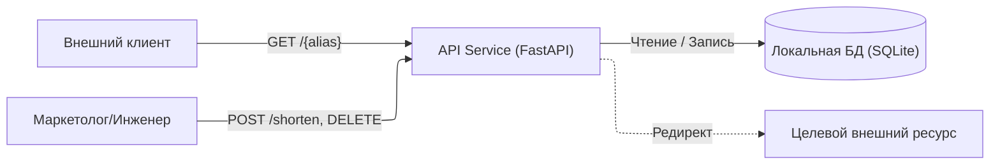
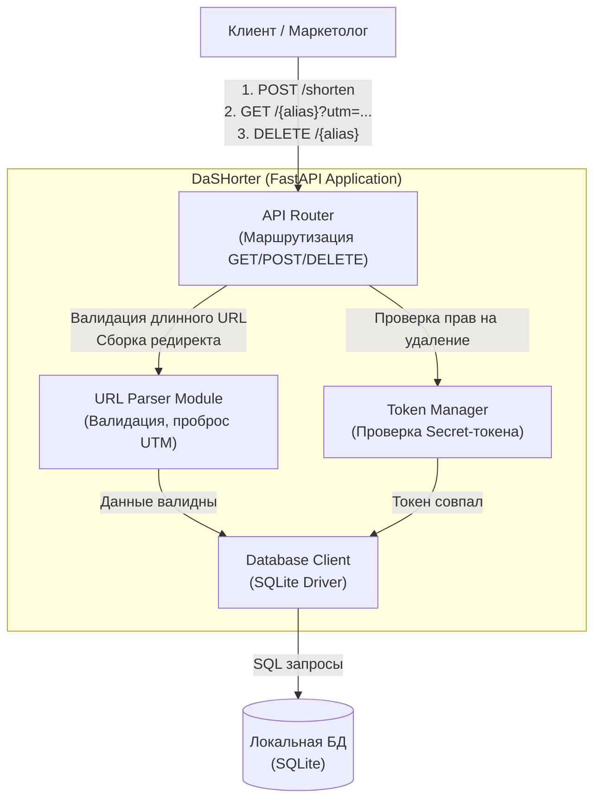

# Проект: DaSHorter>> v. 1.0

## 1. Паспорт проекта

**Участники:** Дараган Даниил Дмитриевич, МСПИН-251 -- Привезенцев Даниил Алексеевич, МСПИН-251  
**Продукт:** DaSHorter. Лаконичный web-сервис кратких ссылок с поддержкой проброса UTM-меток, настраиваемым TTL и управлением через SecretToken
**Планируемый выпуск:** v1.0 - ReleaseCandidate 1
**Исходное состояние:** fc40248d50ab796e15973985ff08279df67a5e46
**Репозиторий:** [<ссылка>](https://git.cs.hse.ru/dddaragan/HighlandTech)

### Контекст и пользователи

Сервис разрабатывается командой из 2 студентов:
Backend-разработчика
QA-инженера/SDET

Цель: Внутреннее использование тестировщиками, маркетологами, разработчиками, публикации ссылок для внешних клиентов.
Решение о выпуске версии принимается совместно обоими инженерами после проверки безопасности логики парсинга URL и маршрутизации.

**Роли пользователей:**
Маркетологи и инженеры: отправляют длинный URL, получают короткий алиас и секретный токен для управления им.
Клиенты: переходят по короткой ссылке. Для них важна скорость редиректа и корректный проброс параметров (напр. ?utm_source=tg для отсылки на всем известный и любимый мессенджер)

### Границы

**В проект входит:**

Backend API -- Стек: Python, фреймворк FastAPI, использование urllib.parse для работы с URL;
локальная база данных для хранения ссылок и статистики -- SQLite;
логика валидации входящих длинных URL;
механизм проброса query-параметров при редиректе;
механизм отзыва ссылки по секретному Secret-токену;
Dockerfile и конфигурация для локального запуска -- docker-compose.

**За пределами проекта:**

GUI управления (frontend/админка);
логика регистрации, логины и пароли пользователей;
публикация сервиса в интернет (развертывание, реальные сервера)

### Компоненты, взаимодействия и границы доверия

**Контекстный уровень:** показывает взаимодействие пользователей с внешним API и перенаправление на сторонние ресурсы.
Здесь проходит главная граница доверия между недоверенной внешней средой и нашим приложением.

**Уровень компонентов**: раскрывает внутреннее устройство DaSHorter. 
Вся бизнес-логика (URL Parser, Token Manager, DB Client) находится внутри единой границы доверия сервера. Валидация всех внешних данных (incl. urllib.parse) 
строго инкапсулирована внутри сервиса до момента обращения к БД.

### Активы и существенные риски

▲ Актив: Токены отзыва.
Что может произойти: Несанкционированный доступ к чужим токенам или их утечка.
Почему это существенно: Злоумышленник сможет удалять чужие рабочие ссылки, нарушая доступность сервиса.

▲ Актив: Целевой URL и механизм редиректа.
Что может произойти: Подмена логики редиректа через манипуляцию query-параметрами.
Почему это существенно: Сервис станет инструментом для фишинга, что приведет к блокировке домена и потере репутации.

▲ Актив: Вычислительные ресурсы сервиса.
Что может произойти: Массовое автоматическое создание мусорных ссылок или исчерпание памяти.
Почему это существенно: Отказ в обслуживании легитимных пользователей -- нагрузка, DoS.

### Доступные материалы и ограничения

- [ ] исходный код и история изменений;
- [ ] возможность собрать или запустить продукт;
- [ ] зависимости и файлы сборки -- requirements, Dockerfile/docker-compose.yml;
- [ ] тесты;
- [ ] конфигурации;
- [ ] CI/CD -- планируется в рамках улучшения;
- [ ] возможность изменить продукт и повторить проверку.

**Недоступно:** Продукт не имеет production-инфраструктуры, анализируется тестовая среда.
**Конфиденциальность:** Ограничений нет, все исходники, схемы и результаты проверок могут быть опубликованы в рамках учебного проекта.  
**Почему проект выполним:** Команда имеет полный контроль над кодом, может локально запустить сервис в контролируемой среде, внести исправления в код и повторно прогнать тесты, получив проверяемый результат.

## 2. Методологическая основа

**Основная рамка:** NIST SSDF 1.1
**Дополнительные источники:** OWASP ASVS 5.0.0

**Требования проекта к рамке:**
- Должна подходить для небольшого web-продукта.
- Должна охватывать весь жизненный цикл, а не только тестирование.
- Должна позволять выбрать небольшой набор применимых практик.
- Должна помогать связать технические результаты проверок с решением о выпуске v1.0.

**Почему выбрана эта основа:** 
Основной рамкой выбран NIST SSDF 1.1, потому что проекту нужна компактная основа полного SDLC, которую можно встроить в наш процесс. OWASP ASVS 5.0.0 используется только как дополнительный каталог проверяемых технических требований для валидации логики API.

Почему? - SSDF не содержит технической специфики web-приложений.

**Что ещё рассматривали (отклонённые варианты):** 
- *ГОСТ Р 56939-2024:* отклонён как основная рамка. Хотя стандарт отлично структурирует процессы, его требования к формальному разделению ролей и документации слишком ёмкие, для MVP двух студентов - рудиментарно.
- *OWASP SAMM 2:* отклонён, так как это модель оценки зрелости в корпо-масштабах, а нашей задачей является проверка конкретного приложения, а не всей организации.

**Выбранные положения основной рамки (NIST SSDF 1.1) для адаптации:**

**1. Источник и положение: NIST SSDF PO.1.1 (Определение требований безопасности).**
Применимость: полностью.
Почему это относится к нашему продукту: перед разработкой API нужно понимать, от кого мы защищаемся.
Какое действие выполняем: зафиксировать границы доверия и модель нарушителя для v1.0.
Кто отвечает: *Дараган Даниил*.
Какой результат остаётся: описание границ в паспорте проекта.
Как проверяет выполнение: ревью текста документа вторым участником (Даниил Привезенцев) перед мерджем.
Что сознательно упрощаем: отказываемся от формального моделирования угроз, оставляем только базовое описание.

**2. Источник и положение: NIST SSDF PS.1.1 (Защита репозиториев кода).**
Применимость: полностью.
Почему это относится к нашему продукту: мы храним исходный код web-сервиса в Git.
Какое действие выполняем: настроить защиту ветки main (запрет прямого пуша).
Кто отвечает: *Дараган Даниил*.
Какой результат остаётся: конфигурация репозитория (Branch protection rules).
Как проверяем выполнение: попытка прямого push в main должна блокироваться системой.
Что сознательно упрощаем: не используем сложные системы управления доступом и ролевые модели, так как нас всего двое.

**3. Источник и положение: NIST SSDF PW.4.4 (Проверка сторонних компонентов).**
Применимость: применима; реализация в учебном MVP ограничена выбранными компонентами и точками контроля.
Почему это относится к нашему продукту: сервис использует FastAPI, Uvicorn и Pydantic, а Docker-образ основан на стороннем образе Python.
Какое действие планируем: перед сборкой и выпуском проверять Python-зависимости и базовый образ на известные уязвимости, оценивать применимость находок и фиксировать решение по каждой блокирующей проблеме.
Кто отвечает: *Привезенцев Даниил* (Backend).
Какой результат остаётся: отчёт или лог проверки с версиями компонентов, идентификатором коммита и решением по существенным находкам.
Как проверяем выполнение: QA/SDET проверяет отчёт и решение; релизный тег не создаётся при нерешённой применимой критической уязвимости.
Что сознательно упрощаем: в этой итерации не вводим непрерывный мониторинг компонентов после выпуска. Проверка только `requirements.txt` не покрывает слои Docker-образа, поэтому они входят в отдельную область проверки. Полное выполнение практики на всём жизненном цикле не заявляется.

**4. Источник и положение: NIST SSDF PW.7.2 (Анализ исходного кода на уязвимости).**
Применимость: частично.
Почему это относится к нашему продукту: код на Python+FastAPI может содержать инъекции и логические ошибки.
Какое действие выполняем: запустить SAST-сканер (Bandit) при создании Merge Request.
Кто отвечает: *Дараган Даниил*.
Какой результат остаётся: лог CI/CD пайплайна с результатами сканирования.
Как проверяем выполнение: MR не вливается без зеленого пайплайна.
Что сознательно упрощаем: не настраиваем DAST и IAST сканирование - только статический анализ.

**5. Источник и положение: NIST SSDF RV.2.2 (Планирование и выполнение реакции на риск уязвимости).**
Применимость: частично реализуется в целевом процессе учебного MVP.
Почему это относится к нашему продукту: ошибки URL-валидации и механизма SecretToken могут нарушить безопасность редиректа и управления ссылками.
Какое действие планируем: фиксировать находку в Issue, оценивать риск и выбирать исправление или временную меру. При применимой критической уязвимости выпуск `v1.0` блокируется до устранения и повторной проверки.
Кто отвечает: *Привезенцев Даниил* (Backend); QA/SDET проверяет результат.
Какой результат остаётся: Issue с риском, решением, ответственным, целевым сроком, ссылкой на исправление и результатом повторной проверки.
Как проверяем выполнение: партнёр просматривает исправление и подтверждает решение перед закрытием Issue и созданием релизного тега.
Что сознательно упрощаем: не вводим единые формальные SLA; срок задаём для конкретной находки с учётом риска и ресурсов команды. Отсутствие SLA не отменяет блокировку выпуска при критической проблеме.

**6. Источник и положение: NIST SSDF RV.3.1 (Анализ первопричин уязвимостей).**
Применимость: применима по смыслу, но сознательно исключена из обязательного профиля текущей учебной итерации.
Почему это относится к нашему продукту: анализ первопричины может предотвратить повтор ошибок в парсинге URL и проверке токенов.
Какое действие выполняем: в рамках этой итерации отдельный процесс RCA не выполняется.
Кто отвечает: отдельный исполнитель RCA не назначен; решение о пересмотре ограничения принимают оба участника.
Какой результат остаётся: описание этого ограничения и условий его пересмотра в `project.md`; отчёт RCA не заявляется.
Как проверяем выполнение: выполнение RCA не проверяем, поскольку практика исключена из выбранного профиля. QA/SDET проверяет, что ограничение явно учтено в решении о выпуске.
Что сознательно упрощаем: не оформляем отдельные отчёты RCA для каждой находки. При повторной или серьёзной уязвимости либо развитии эксплуатации пересматриваем решение. Риск повторения дефекта остаётся; ревью исправлений и регрессионные тесты планируются как компенсирующие меры, но не заменяют RCA.

### Итоги адаптации методологии

NIST SSDF 1.1 используется как основа выбранного профиля практик. Полное соответствие SSDF не заявляется: отдельный процесс RCA исключён из текущей итерации, а разделение обязанностей реализуется двумя участниками через проверку работы партнёром. Для контроля зависимостей и выпуска запланированы конкретные артефакты; их наличие и фактическое применение ещё предстоит проверить. Выбор SAST- и SCA-инструментов предварительный и уточняется после лекций 06–08 и при проектировании CI/CD.

Источник формулировок PW.4.4, RV.2.2 и RV.3.1: [NIST SP 800-218, SSDF 1.1](https://nvlpubs.nist.gov/nistpubs/SpecialPublications/NIST.SP.800-218.pdf), таблица 1. Карточки выше описывают целевой процесс и ограничения, а не уже выполненные проверки.

## 3. Текущее состояние

Область наблюдения — содержимое и история репозитория до [cff2b63b](https://git.cs.hse.ru/dddaragan/HighlandTech/-/commit/cff2b63b864833805a636e21d2a160df8d227124).
В этой истории 13 коммитов, включая пять коммитов слияния веток в `main`; утверждать, что все изменения внесены прямыми push в `main`, по ней нельзя.
На публичной странице веток `main` помечена как `protected`. Конкретные разрешения на прямой push и обязательность независимого одобрения не подтверждены доступными настройками.
В наблюдаемом дереве присутствуют документация, `requirements.txt`, `Dockerfile` и `docker-compose.yml`, но нет исходного `main.py`, тестов и `.gitlab-ci.yml`. Запуск приложения и ручных тестов на этом срезе не подтверждён; в GitLab есть следы неуспешных pipelines, которые сами по себе не подтверждают работающие проверки безопасности.
Подготовка релиза, успешная сборка Docker-образа и проверка безопасности зависимостей пока не подтверждены сохранёнными результатами.

*Сохраняемые сильные элементы:* Состав Python-зависимостей указан в `requirements.txt`, а контейнеризация описана в `Dockerfile` и `docker-compose.yml`. Это основа для дальнейшего внедрения проверок. Указаны нижние границы версий (`>=`), а не точные версии; воспроизводимость разрешённого набора зависимостей ещё предстоит обеспечить.

### Существенные разрывы

**DEV: Инфраструктура и Git**

Заявленное правило проверки значимых изменений вторым участником требует подтверждения фактическими настройками и следами ревью.

- *Объект и область наблюдения:* правила слияния в `main` и история изменений до указанного baseline.
- *Применимое ожидание и его источник:* значимое изменение проверяет второй участник; основание — паспорт проекта, выбранная практика защиты репозитория и целевые правила слияния в разделе 4.
- *Что фактически показано, ссылка на след:* в истории есть слияния через MR, например [MR !5](https://git.cs.hse.ru/dddaragan/HighlandTech/-/merge_requests/5), и [страница веток](https://git.cs.hse.ru/dddaragan/HighlandTech/-/branches) показывает `main` как защищённую. Эти наблюдения не доказывают запрет прямого push и обязательность одобрения именно партнёром.
- *Что пока неизвестно и почему вывод ограничен:* не установлены конкретные настройки `Allowed to push`, `Allowed to merge` и обязательного независимого ревью. Значения этих настроек не восстанавливаются из одной истории Git; возможные локальные обсуждения и проверки в неё не входят.
- *Точное расхождение:* для заявленного обязательного ревью вторым участником пока не сохранено проверяемое подтверждение технического ограничения или фактического выполнения. Это разрыв в свидетельствах, а не установленный факт отсутствия защиты.
- *Почему оно важно:* без подтверждённого порядка ревью возможно попадание непроверенного изменения в логику валидации и управления токенами.
- *Ближайшее действие:* проверить реальные правила ветки, сохранить свидетельство настроек и пример MR с ревью партнёра. Если запрет прямого push или независимое ревью не обеспечены, настроить их доступным способом и проверить на тестовой ветке; при отсутствии технического механизма явно описать ручной контроль и его ограничение.
- *Приоритет:* средний; контроль нужен до слияния значимых изменений и подготовки выпуска.

**QA**:
Тесты и безопасность
На текущем этапе перехода к выпуску не наблюдалось; автоматизированный запуск тестов при слиянии и проверка состава Docker-образа не настроены
- *Объект и область наблюдения*: Логика парсинга urllib.parse и тесты в репозитории.
- *Применимое ожидание и его источник*: Обещанное свойство безопасности "защита редиректа от фишинга" должно проверяться перед выпуском. 
- *Что фактически показано, ссылка на след*: В доступном baseline отсутствуют автоматизированные security-тесты на подмену query-параметров.
- *Что пока неизвестно и почему вывод ограничен*: Неизвестно, проводилась ли ручная проверка валидации на локальной машине, так как задокументированных следов нет.
- *Точное расхождение*: Для обещанного свойства безопасности "корректный редирект" не показан проверяемый результат перед выпуском.
- *Почему оно важно*: Уязвимость в парсере приведет к фишингу и компрометации сервиса.
- *Ближайшее действие*: Написать набор Pytest-сценариев для фаззинга и проверки мусорных URL и интегрировать их запуск.
- *Приоритет*: Высокий, напрямую затрагивает главный актив продукта.

## 4. Целевой Secure SDLC

### Правила слияния (Merge)

Изменения готовятся в отдельной рабочей ветке от актуальной main на основе проектных требований к безопасности и рискам [NIST SSDF PO.1.1 (п. 3, 4, 6): учет требований к проекту, доведение их до разработчика и тестировщика, а также контроль сторонних компонентов через фиксацию зависимостей]. Автор создаёт Merge Request в main, описывает цель и состав изменения, связывает относящиеся к нему Issues и прикладывает результаты применимых проверок.
Проведение перекрестного код-ревью и анализа исходного кода [NIST SSDF PW.7.2 (п. 1–5): проверка по правилам безопасной разработки, комбинация ручного ревью и статанализа, фиксация замечаний, их триаж и передача исправления автору]. Backend-изменения проверяет Д. Дараган (QA/SDET), а изменения QA и документации партнёра - Д. Привезенцев (Backend). Автор не заменяет ревью собственной работы своим одобрением. Все обнаруженные замечания фиксируются непосредственно в Merge Request; слияние блокируется до устранения находок автором

До слияния проверяем:

- diff, соответствие согласованной цели и отсутствие лишних файлов или секретов;
- для документации — читаемость, ссылки, согласованность ролей и различие между планом и выполненной проверкой;
- для кода и зависимостей (включая проверку requirements.txt) — результаты применимых тестов, SAST и SCA-сканирования [**NIST SSDF PW.4.4 (п. 1, 2, 3)**: проверка известных уязвимостей сторонних компонентов, автоматическое сканирование и контроль их актуальности], рассмотренные находки и отсутствие нерешённых блокирующих проблем;
- обязательное одобрение второго участника и отсутствие неразрешённых замечаний.

Слияние в `main` выполняет Д. Привезенцев после ревью; создание релизного тега и решение о выпуске относятся к отдельной точке контроля QA/SDET. Новые существенные изменения после одобрения предъявляются партнёру повторно. После внедрения CI действует требование зелёного pipeline из карточки PW.7.2. До внедрения автоматизации ручной запуск применимых проверок допускается только как согласованное временное исключение по правилам ниже: сохраняем результат, версию инструмента и SHA проверяемого коммита, указываем срок перехода к CI. Отсутствие результата не считается успешной проверкой, а сбой уже внедрённого CI не разрешает обход pipeline. 

Для обеспечения защиты кода и артефактов [NIST SSDF PS.1.1 (п. 1, 2, 5): ограничение доступа к репозиторию, минимизация прав на изменение кода и разделение ролей при слиянии и выпуске] установлен жесткий запрет прямого push в main. Техническое требование обязательного одобрения вторым участником должно быть проверено и зафиксировано в настройках репозитория; одна метка protected этого не доказывает

### Исключения и обработка уязвимостей

Нарушение правил или наличие выявленных уязвимостей обрабатываются по регламенту [**NIST SSDF RV.2.2 (п. 1, 2, 4, 5)**: выбор стратегии обработки риска, приоритезация, применение временных мер смягчения и документирование решений.]

Запрос на исключение / Временные меры: Если правило выполнить невозможно вовремя, в Issue или MR фиксируются конкретная причина, затронутая проверка, оценка риска, временная мера смягчения, ответственный и срок пересмотра [RV.2.2 п. 2, 5]. Решение принимается парой совместно; автор изменения не одобряет исключение единолично. Исключение связывается с конкретной версией релиза.

Обработка открытых вопросов и блокировок: При недоступности второго участника слияние откладывается. При отсутствии обязательного свидетельства либо наличии неисправленной критической уязвимости выпуск задерживается или его объём пересматривается после устранения причиной проблемы [RV.2.2 п. 1]. Доставка исправлений осуществляется исключительно через выпуск новой тегированной сборки Docker-контейнера [RV.2.2 п. 4]. Фиктивные одобрения и подмена отсутствующих результатов не допускаются. Принятие ограниченного остаточного риска не отменяет указанные блокирующие условия.

**Точка контроля выпуска и разделение слияния:**
- *КТ*: Слияние и выпуск разнесены по времени и ролям. Слияние кода в ветку main выполняет Д.Привезенцев после код-ревью. Выпуск версии v1.0 инициирует и проверяет SDET/QA - Д.Дараган
- *Условие готовности релиза*: Перед тегированием версии v1.0 ответственный за выпуск (QA) проверяет локальный или сборочный запуск базового набора тестов и подтверждает отсутствие критичных отклонений. Зеленый результат базовых тестов не заменяет проверку безопасности URL-парсинга.
- *Лицо, принимающее решение*: Решение о выпуске фиксирует QA на основании успешных результатов проверки стабильности и конфигурации docker-compose.

**Эскалация, исключения и работа после выпуска:**
- *Открытый вопрос || нехватка данных:* Если перед выпуском результат нужной проверки (e.g. проверка работы SecretToken) не найден или неоднозначен, выпуск задерживается до уточнения истории коммитов с разработчиком.
- *Запрос на исключение:* Если правило прохождения проверок нарушить невозможно, а релиз срочный, решение об отсрочке или изменении объема принимается парой совместно. Фиктивные права обхода правил отсутствуют.
- *Сообщение после выпуска и предотвращение рецидивов:* Канал обратной связи и обнаружения проблем после релиза - TG команды и мониторинг логов контейнера FastAPI. При обнаружении сбоя (например, ошибки редиректа) фиксируется затронутая версия и проводится совместный анализ первопричины [**NIST SSDF RV.3.2 (п. 1–3)**: фиксация root cause, сохранение уроков и защита от повторения ошибки]. По результатам разбора вносятся исправления в код и обязательно дорабатывается тестовый сценарий (regression tests), чтобы предотвратить повторный дефект в будущих версиях.

## 5. Технологический профиль

### Метод 1: Проверка безопасности парсинга и валидации вводов

**Риск или свойство:** Уязвимость логики редиректа, обход ограничений схемы (инъекция JS) и некорректная обработка SecretToken (OWASP ASVS V5).
**Цель:** Доказать, что встроенный парсер DaSHorter корректно отбрасывает мусорные, нестандартные и потенциально малварные URL при создании короткой ссылки.
**Область проверки:** Модули валидации URL в коде FastAPI и обработка параметров запроса.  
**Этап жизненного цикла:** Перед релизом.
**Способ или инструмент и версия:** Предварительно - параметризованные security-тесты + фаззинг краевых значений. Точный выбор инструмента будет произведен после лекций 6-8.
**Ведущий участник:** Дараган Даниил (AQA/SDET).
**Как партнёр проверит результат:** разработчик проверит тестовые сценарии на ревью и просмотрит итоговый лог покрытия перед подтверждением готовности. 
**Ожидаемые свидетельства:** Журнал успешного прогона автоматизированных security-тестов для целевой версии v1.0
**Что метод не покрывает:** Метод проверяет только корректность обработки данных нашим кодом и не находит известные CVE в сторонних библиотеках

### Метод 2: Анализ безопасности состава зависимостей (SCA)

**Риск или свойство:** использование Python-пакетов и компонентов базового Docker-образа с известными применимыми уязвимостями может нарушить конфиденциальность данных или стабильность DaSHorter.
**Цель:** выявлять и разбирать известные уязвимости сторонних компонентов до включения целевой сборки в выпуск `v1.0`.
**Область проверки:** Python-зависимости из `requirements.txt` вместе с их транзитивными зависимостями и базовый образ `python:3.11-slim` из `Dockerfile`. Для воспроизводимости фиксируем фактически разрешённые версии пакетов и digest проверяемого образа; текущие ограничения `>=` этого не обеспечивают.
**Этап жизненного цикла:** при подготовке значимого изменения зависимостей к слиянию и при сборке контейнера перед выпуском.
**Способ или инструмент и версия:** предварительно — SCA-анализатор, например `pip-audit` для Python-пакетов и Trivy для контейнера. Точные инструменты и версии выбираются после лекций 06–08; результатов их запуска сейчас не заявляем.
**Ведущий участник:** Привезенцев Даниил (Backend).
**Как партнёр проверит результат:** QA/SDET проверяет область сканирования, применимость находок, решения по ним и связь отчёта с целевым коммитом и образом. При нерешённой применимой критической уязвимости выпуск блокируется.
**Ожидаемые свидетельства:** отчёт или лог сканера, команда запуска и конфигурация, версия инструмента, версии пакетов и digest образа, SHA коммита, решения по существенным находкам и результаты повторной проверки после исправления.
**Что метод не покрывает:** бизнес-логику, безопасность собственного URL-парсинга и SecretToken, неизвестные уязвимости и компоненты вне фактически просканированной области. Отсутствие находок не доказывает полную безопасность сервиса.

## 6. Практическая апробация

Для каждого выбранного метода укажите:

- что именно проверялось;
- команду запуска или понятную последовательность действий;
- версию инструмента и ссылку на конфигурацию;
- ссылку на существенные результаты в `evidence/`;
- что удалось и не удалось воспроизвести;
- какие ограничения есть у результата.

## 7. Результаты и триаж

Соберите только существенные результаты. Для каждого результата укажите:

- вывод: подтверждён / ложное срабатывание / неприменимо / требует дополнительной проверки;
- основание решения;
- влияние на планируемый выпуск;
- ссылку на свидетельство.

Если существенных проблем не найдено, так и напишите. Объясните, что именно было проверено, почему результат содержателен и чего он не доказывает.

## 8. Улучшение и повторная проверка

**Что улучшили:** ...  
**Какой риск или разрыв это уменьшает:** ...  
**Почему выбрано именно это улучшение:** ...  
**Ссылка на изменение:** ...  
**Как повторили проверку:** ...  
**Результат до и после:** ...  
**Вклад первого участника:** ...  
**Вклад второго участника:** ...

Улучшение может относиться к коду, конфигурации, сборке, тестированию, настройке проверки или воспроизводимости. Специально создавать уязвимость не нужно.

## 9. Решение о выпуске

**Решение:** выпускать / выпускать с условиями / отложить выпуск  
**Основания:** <ссылки на ключевые результаты>  
**Блокирующие проблемы:** <есть или нет>  
**Остаточные риски:** ...  
**Условия, исключения и ответственные:** ...

Поясните, почему собранных свидетельств достаточно именно для такого решения, а не для утверждения о полной безопасности продукта.

## 10. Метрики и программа развития

Укажите несколько полезных показателей и план улучшений на 6–12 месяцев. Для ближайших действий задайте приоритет, ожидаемый результат и ответственного. Не добавляйте метрики, которые команда не сможет интерпретировать.

## 11. Управленческая записка

<Краткое самостоятельное резюме: продукт и выпуск, что проверено, что улучшено, какие риски остались и какое решение предлагается. Ориентир — около одной страницы без пересказа всего проекта.>

## 12. Использование генеративного ИИ

**Использовался ли ИИ:** да / нет  
**Для чего:** ...  
**Какие части продукта или проекта созданы с его помощью:** ...  
**Какие данные передавались:** ...  
**Как команда проверила результат:** ...

Не публикуйте промпты целиком, если это не помогает проверить результат.